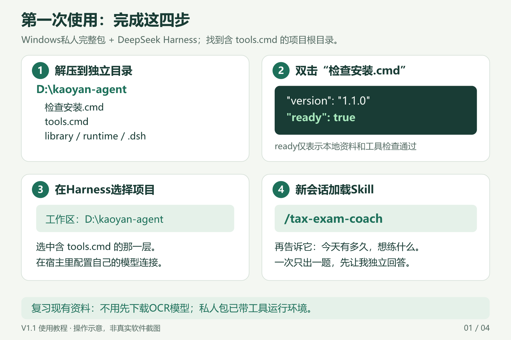
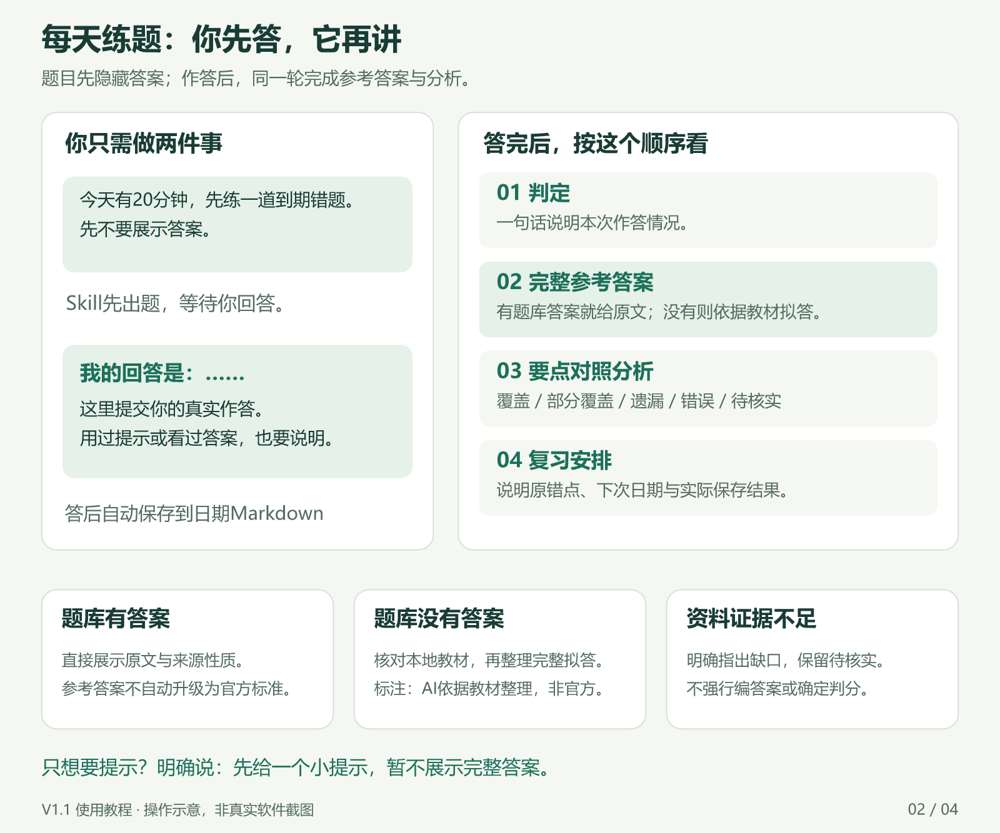
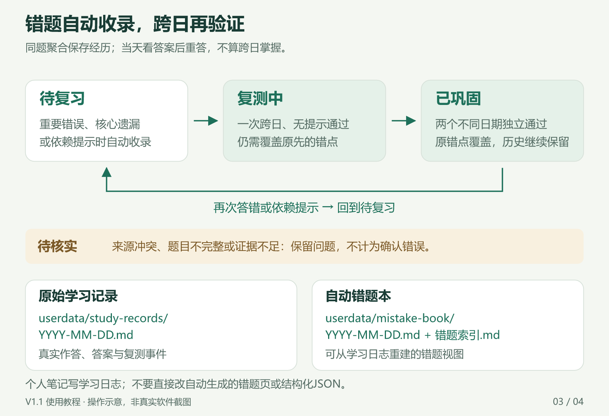
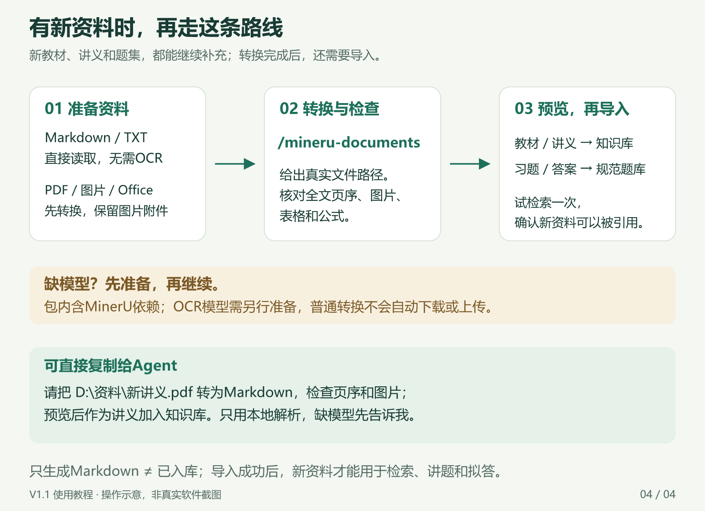

# V1.1 图文使用教程

以下均为操作示意图，非真实软件截图。按启动、练题、错题复测、补充资料的顺序阅读。

## 第一次启动

解压私人完整包，检查ready，选择整个项目，加载 /tax-exam-coach。

> 今天有20分钟，请先检查本地资料和到期任务，一次只出一题，先让我独立回答。

## 日常练题

提交真实作答后，依次查看判定、完整参考答案、逐点分析和复习安排。

> 答完后请直接给完整参考答案，再逐点分析，最后说明复测日期和实际保存位置。

## 错题与记录

关键错误和提示依赖自动收录；两次不同日期独立通过、覆盖原错点后标记已巩固。

> 今天先练到期错题，只给题干，不展示我的旧答案和解析，答完再对照原错点分析。

## 新资料导入

Markdown直接读取，其他支持格式使用MinerU转换；检查与预览之后，再导入对应资料库。

> 请把 D:\资料\新讲义.pdf 转为Markdown，检查页序和图片；预览后作为讲义加入知识库。只用本地解析，缺模型先告诉我。

## 遇到问题

找不到Skill时先核对工作区；缺少OCR模型时先准备资源；备份保留userdata，新增教材随整个项目保留。

完整步骤见[文字版教程](user-guide.md)。[浏览器图文版](user-guide-illustrated.html)内嵌示意图，可单独复制给朋友。
