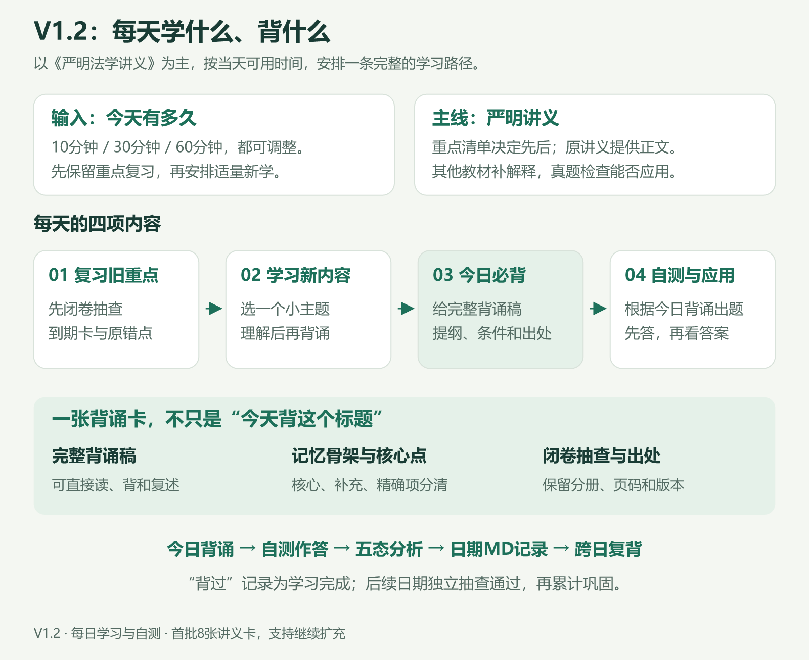

# V1.2 方案：每日学习、讲义重点背诵与自测

实施日期：2026-11-13。V1.2工具与Skill已接入每日计划、背诵卡和今日自测，延续DeepSeek Harness、本地资料与日期Markdown。私人包先提供8张可追溯起步卡，后续通过卡片工具扩充；不宣称整本讲义已完成拆卡。实际验证边界见 [验证记录](verification.md)，使用入口见 [V1.2教程](v1.2-guide.md)。

用户已确认：**每天按当天可用时间灵活调整。背诵内容以《严明法学讲义》为主。** 目标仍为2027年12月初试、边工作边备考；下文30分钟仅为展示样例，不是固定学习时长。

本轮追加：**根据当天实际背诵的内容出自测题，先答后看答案，并与要点分析、错题本和复背安排衔接。**



## 1. 每天打开后，先看到什么

在新会话加载 `/tax-exam-coach` 后，可以直接说：

> 安排今天的学习，我今天有30分钟。先复习到期重点，再按严明讲义安排新的背诵内容，背完后根据今天实际背的内容出自测题；一次一题，答完再给答案与分析。

Skill按电脑本地日期加载当天任务，并展示四个部分：

| 今日任务 | 具体给什么 | 完成依据 |
| --- | --- | --- |
| 复习旧重点 | 今天到期的背诵卡和原错点，抽查时先隐藏正文 | 实际提交的回忆/默写及逐点反馈 |
| 学习新内容 | 一个与已有知识衔接的讲义小主题，给阅读位置与理解提示 | 阅读/学习记录，区别于独立通过 |
| 今日重点背诵 | **可直接背的完整正文、记忆骨架、关键条件和来源** | 记录已学习；抽查后另记覆盖结果 |
| 今日自测与应用 | 根据今日已背内容出题；可匹配真题或生成有依据的自测小问 | 保存题目、考查要点、原始作答、答案、分析和错题记录 |

任务清单同时标明“为什么今天安排它”、预计用时和可选内容。使用者可以说“今天只复习”“今天只剩10分钟”“换到国际税法”，调整尚未完成的部分。

每天进入Skill时生成/加载任务；本版方案不要求后台常驻或定时推送。日程安排与实际完成记录分开。

## 2. 背诵材料怎么选

### 来源分工

| 资料 | 在V1.2中的作用 |
| --- | --- |
| 《严明法学讲义》原文 | 背诵正文、概念、必要条件与结构的主依据 |
| 讲义2023—2026真题重点清单 | 排优先顺序、识别主题与关联题目 |
| 讲义重点批注版 | 辅助定位和阅读，新增批注不充当原讲义结论 |
| 原有教材 | 补充解释、核对边界或冲突，补充内容单独列明 |
| 中英文对照资料 | 在相应主题下安排术语或简短英文表达 |
| 真题与参考答案 | 检查知识如何进入答题，不替代讲义背诵主线 |

真题讲解继续沿用V1.1的答案来源与证据规则；背诵任务以讲义为主，不改变原题库参考答案的来源性质。

### 顺序依据

现有重点清单包含中国税法7个模块、国际税法9个模块；A1/A2/B是来源给出的复习顺序建议，不是命题概率。安排时结合：

1. 到期复背及最近的核心错点。
2. 新主题需要的前置知识；复杂制度先补必要概念。
3. 清单优先级、与真题的关联和个人薄弱点。
4. 尚未覆盖的章节，持续推进A2和B类基础覆盖。

默认以一个小主题推进，不强制中国/国际逐日轮换；使用者可以指定科目。没有相关真题的必要基础知识，也能进入学习任务；应用题可使用明确标注的AI自拟题。

## 3. 把讲义变成“可背诵的卡片”

一张卡围绕一个可独立复述的知识点。长论述拆成“总框架卡＋分点卡”，避免一次给整章或数页正文。

### 每张卡必须包含

| 字段 | 内容 |
| --- | --- |
| 主题与目标 | 今天要能说清什么，适合名词解释、简答还是比较 |
| 完整背诵稿 | 保留定义、结构、条件与边界，可直接阅读和背诵；AI整理部分明确标注 |
| 记忆骨架 | 提纲和关键词，作为辅助，不能代替完整正文 |
| 核心与补充 | 必须覆盖的内容、理解材料及可后置拓展分别标记 |
| 精确项 | 需准确保留的数字、条件、期限或术语；不机械要求所有理论表述逐字一致 |
| 抽查问题 | 闭卷时只显示提问，不显示正文、骨架与答案 |
| 来源定位 | 来源ID与哈希、分册、分册PDF页序、合并页序/锚点和引用块 |
| 版本与关联 | 稳定卡片ID、内容版本、知识点ID、相关真题ID；没有真题就留空 |

**不能只推送“今天背税收法定原则”，然后让使用者自己找内容。** 卡片需给出完整可背正文，同时保留到原讲义的定位。

### 质量门槛

- 从原讲义正文构建卡片，不能把搜索排名第一的结果直接作为背诵稿。目录、纯标题、前言、跨页截断不能独立构成一张有效卡。
- 先读取主题对应正文和必要上下文，再区分基础内容、拓展论文、作者主张、旧规则与征求意见稿；存在争议的部分标记待核实。
- 核心要点必须有可核对原文；重点清单和模型概括不代替原文证据。引文存在也不自动证明概括正确。
- 六册页序会重置，必须保留分册和合并页序；原件缺失的国际讲义印刷164—165页不补造。
- 来源中的历史备考日期、旧“现行”表述不直接当作2027年考试要求；没有外部核验时不宣称规则已更新到考试年度。
- 更新讲义或卡片时保留旧版本及历史引用，已有记录不被新稿覆盖。

### 一张卡的展示示例

> **今日必背01｜税收法定原则：核心框架**  
> 学习目标：脱稿说明含义与基本内容。  
> 完整背诵稿：已由卡片工具依据所列讲义原文提供完整正文，不以几个关键词代替；用card --learn读取。  
> 记忆骨架：含义 → 基本内容 → 必要边界。  
> 抽查题：请在不看资料的情况下说明本主题的核心内容。  
> 来源：原讲义第1分册PDF第29页，合并页序29，`textbook-page-29`；内容延伸需另核对相邻页面。  
> 关联：从当前题库匹配真实题目并保留ID，没有匹配就不冒称真题。

这是展示结构示例；私人包中有该主题的实际起步卡。卡片可追溯原讲义，不代表该页已做现行法核验。

## 4. 每天任务量怎么调整

只在当天时间尚不明确且影响任务量时询问。可以保留用户的常用偏好，但不能把上次“有60分钟”直接认定为今天仍有60分钟。

| 当天时间示例 | 建议起始任务量 | 时间预算示例 |
| --- | --- | --- |
| 10—15分钟 | 优先复背1—2张旧卡；有余量再学一个小点 | 复背与核对约10分钟，记录及安排约2分钟，其余可选 |
| 30分钟 | 旧卡约2张、新卡约1张、一个相关小问 | 复背8＋新学/背诵12＋应用8＋记录2分钟 |
| 60分钟 | 旧卡约3张、新卡约2张、一个应用任务 | 复背15＋新学/背诵25＋应用15＋记录5分钟 |

数量和用时是初始估计，按卡片难度、实际完成情况与使用者反馈调整，不保证每张卡相同耗时。新卡预算包括理解、背诵与核对，不按“每天固定背几页”排任务。

基本约束：

- 任务总预算不超过当天可用时间；核心任务和有余力再做的可选项分开。
- 到期任务超出预算时，优先最近出错、逾期较久且关键的内容，压缩新学量，显示哪些项目顺延。
- 同一知识点的背诵与真题复测可合并为一次任务，避免重复占用预算；记录仍保留各自来源。
- 没完成的任务重新排期，不把几天的未完成量全部堆到次日。
- 同一天重复打开返回同一计划及进度；调整时间或范围时生成计划修订，只调整未完成任务。
- 用户说“还剩10分钟”时按剩余时间重排待办，保留已经完成的部分；不把模型估计当成实际计时。
- 当天没有学习就保留未完成/跳过状态，不伪造作答、补签通过或累计掌握天数。

## 5. 背诵、抽查和掌握怎么区分

### 一个完整学习过程

```text
开始：先闭卷抽查到期旧卡
  ↓
学习：阅读新卡正文与讲义出处，理解后背诵
  ↓
练习：合上资料，提交自己的复述/默写
  ↓
反馈：简短判定 → 正文/参考表达 → 五态逐点分析 → 复背安排
  ↓
自测：根据今日实际背诵内容出题，先作答，再给答案与分析
  ↓
结束：记录实际完成情况，安排以后日期的独立抽查
```

看过当天新卡后的立即复述属于学习练习；看完讲解后的同主题应用也应保留提示/学习背景，不据此制造跨日独立通过。

### 每日自测：根据今天背的内容出题

**出题范围取今天实际学习/背诵过的卡片及其版本**，包括今天复背过的旧卡；仅排进计划、尚未学习的卡片不自动进入当日自测。若今天还没有背诵记录，先提示选择或学习卡片，不凭空假设已学范围。复习其他日期内容时，由使用者明确指定。

出题前将卡片的核心要点映射到题目，按“记得住 → 分得清 → 用得出”选择适合的形式：

| 自测形式 | 检查什么 | 使用条件 |
| --- | --- | --- |
| 回忆/简答 | 能否不看材料说出概念、结构与必要条件 | 默认优先，每次只显示一道题 |
| 判断并说明理由 | 能否识别条件遗漏或概念混淆 | 理由是判定的一部分，不能仅凭猜对正误算通过 |
| 比较辨析 | 能否说明相近概念的共同点、差别与边界 | 对应比较点必须在今日已背范围中 |
| 小案例/应用 | 能否把今天的知识用于一个具体情境 | 条件和预期答案能被讲义支持；时间不足时可不安排 |

默认数量随剩余预算调整：10—15分钟任务可安排1道短题；30分钟任务可从1—2道起步；60分钟任务可安排3—5个短设问，其中至多安排一个较长应用任务。**出题、作答、反馈都计入当天预算**，不是原计划做完后再额外加一套题。数量可由使用者指定，但应显示预计用时和可顺延项。

生成和答题规则：

- 每题绑定卡片ID/版本、考查要点ID和原讲义证据。不能仅凭章节标题或模型记忆出题，不能强行考今天未学的规则。
- 先匹配真实题库中范围相符的题目；题目只部分落在今日范围时，可以忠实引用能独立作答的小问并保留来源；改编题须标明改编，不把自拟题称为真题。
- AI生成题明确标为“AI依据今日背诵内容生成的自测题”，不伪造年份、官方答案或评分细则。
- 出题时固定参考答案和考查要点，但作答前的工具返回及展示只含题干；不提前展示背诵稿、答案、要点清单或暗含答案的提示。
- 提交后按V1.1顺序给出：简短判定 → 完整参考答案与出处 → 实际作答的逐点分析 → 错题/复背安排。
- 已测和未测的核心点分别标记；一道题答对，不等于整张卡或整个主题全部通过。证据不足或题目有歧义时进入待核实。
- 错误、重要遗漏或提示依赖按来源进入现有错题本；已看过当天背诵稿的即时自测属于学习训练，不直接增加跨日独立通过次数。
- 同一次自测任务重复打开/保存不重复建题和计次；明确要求“再出一组”时建立新题目版本，保留已有作答。同日多组练习不制造多个跨日通过。

自然语言入口：

> 我今天背完了。根据今天实际背的内容出两道自测题，一次一题，先不要给答案。

> 只针对刚才遗漏的要点再出一道题，换个问法，答完再分析。

展示示例：假设今日已背卡是“税收法定原则的含义与基本内容”，可以出“请脱稿说明其含义，并分点概括基本内容”。比较题、判断题和应用题须先核对卡片范围及讲义依据。本示例仅说明出题方式，不代表本轮已经生成正式试题。

### 状态分开记录

| 发生了什么 | 记录为什么 | 能否直接算掌握 |
| --- | --- | --- |
| 展示了卡片 | 已展示/开始学习 | 否 |
| 使用者说“背完了” | 自报完成，允许推进当天计划 | 否，不虚构抽查结果 |
| 当天看正文后复述 | 实际作答＋要点结果＋已看正文标记 | 否，可算本次学习完成 |
| 后续日期闭卷抽查通过 | 实际作答、无提示、原错点覆盖情况 | 计入跨日通过 |
| 核心错误/遗漏或依赖提示 | 关联错因与待复背任务 | 进入错题或待复背 |
| 资料冲突或无法核实 | 待核实及具体原因 | 不计为确认错误或独立通过 |

背诵抽查以实际提交的文字为判断依据。理论性内容接受意思正确的同义表述；数字、必要条件与明确要求精确的项目单独核对。

复背沿用可配置的1/3/7/14/30天起始间隔，由实际失败/提示依赖调整；这是一套调度规则，不是记忆效果保证。至少两个不同日期、晚于最近出错日期的无提示通过，覆盖原错点后，才进入相应的已巩固状态。

## 6. 与V1.1真题、错题本怎么衔接

- 保留已有“判定 → 参考答案 → 分析 → 复习安排”的顺序。
- 把背诵卡抽查与真题练习映射到共同知识点；背诵失误也可自动收录，但明确标为“讲义背诵抽查”，不冒充历年真题。
- 每日自测保留“原真题 / 改编题 / AI自拟题”的真实来源、卡片版本与覆盖要点，支持依据未覆盖或易错点继续出题。
- 同一知识点下的不同真题仍保留各自题目ID；合并任务不等于合并作答历史，也不把一次作答当成两次通过。
- 原错点、卡片版本、使用提示与已看正文情况进入记录；纠正/取消反馈后重算任务和错题状态。
- 只看了卡片、没有作答，不能自动判错或生成不存在的错题；自报完成也不自动获得正确判定。
- 旧V1.1日志继续读取，没有背诵经历就显示未记录，不从旧聊天或总分推造背诵进度。

## 7. 每日内容怎样落到Markdown

实际采用以下相对目录，仍保存在朋友电脑中：

```text
library/
  recitation-cards/                 依据讲义生成、可追溯版本的背诵内容资产
    <card-id>/<version>.md
userdata/
  daily-plans/
    YYYY-MM-DD.md                  当日任务、预算、安排理由与计划修订
  daily-self-tests/
    YYYY-MM-DD.md                  当日自测题目、版本和覆盖范围；题干视图不含答案
  study-records/
    YYYY-MM-DD.md                  真实作答、反馈、自报完成、跳过/调整等事件
  mistake-book/
    YYYY-MM-DD.md                  自动错题与复背视图
    错题索引.md
```

计划文件保存“准备做什么”；日期学习日志保存“实际发生了什么”，后者仍是个人学习事实来源。计划完成状态、错题状态和到期安排从日志重建，缓存丢失不丢失学习事实。

每日计划保存时间预算、任务ID、卡片/题目版本、原文定位和顺延原因。同日刷新不重复建任务，修改计划保留修订，不覆盖用户笔记或已完成经历。未来日期可以安排任务，但不能提前写入完成记录。

自测题目文件保存出题任务，实际回答、已展示答案、逐点反馈与复测事件统一写入当日study-records。完成状态仍从日志重建，不能只靠自测试卷上的勾选认定答对。

`library/recitation-cards`属于私人知识内容，`userdata`属于个人数据，两者均不进入公开仓库；公开代码只保留自制样例和格式定义。升级应同时保留用户新增的教材/卡片与学习日志。

## 8. 首周主题示例

以下是初次使用者的主题顺序示例，不是已经排好的真实日期任务，也不是锁定每天30分钟。

| 学习日 | 新学/背诵主题 | 同时做什么 |
| --- | --- | --- |
| 第1天 | 税收法定原则的核心框架 | 熟悉卡片、出处和复述方式 |
| 第2天 | 实质课税原则的核心框架 | 先抽查第1天到期内容 |
| 第3天 | 税收债务关系说与权力关系说的比较 | 按实际覆盖调整旧卡复习 |
| 第4天 | 课税要素的答题结构 | 选一个相关名词解释或小问 |
| 第5天 | 分类、综合与分类综合所得税制的比较 | 从讲义定位对应正文，再关联真题 |
| 第6天 | 复盘本周遗漏，无强制新卡 | 汇总易混点，用一题检查应用 |
| 第7天 | 机动补缺或轻量复背 | 依据剩余时间安排下一阶段 |

后续逐步进入个税、增值税、企业所得税、征管救济以及国际税法对应模块。每个主题的实际顺序、拆卡数量和题目都在核对讲义、前置知识和个人记录后确定。

## 9. 模块划分

以下能力已接入V1.2；V1.1原有发行包保持原样。

| 位置/模块 | 拟负责什么 |
| --- | --- |
| recitation.py | 从讲义构建内容、核对证据、稳定ID、版本、抽查视图；首批卡通过build_recitation_seed.py构建 |
| daily.py | 按本地日期、可用时间、到期记录和覆盖进度排任务；支持顺延和修订 |
| selftests.py | 默认生成闭卷回忆题；接收宿主模型依据今日已背内容拟好的变式，验证范围、要点、版本和预算，分离题干与答案 |
| 统一练习记录 | 增加背诵练习来源、卡片版本、正文曝光、自报完成与实际抽查信息，兼容旧记录 |
| 复习与错题投影 | 统一知识点关联、去重安排、纠错重算，区分学习完成和独立通过 |
| CLI与Skill | 提供今日任务、开始背诵、今日自测、闭卷抽查、调整时间的入口；Skill只负责教学决策与路由 |
| 配置与文档 | 当天时间、主讲义、优先级、任务上限和复背间隔成为真实可读取设置；不能只改配置样例就宣称生效 |

当前先选中国税法4张、国际税法4张基础卡，后续按原讲义和重点清单扩展，显示真实卡片与覆盖点；未将446页全量转换结果计作已完成高质量拆卡。题目与参考答案的语义对应仍由宿主模型核对，字段和引文校验不替代教学质量验收。

## 10. V1.2验收标准

1. 指定今天10/30/60分钟，生成不同量级的可执行任务，预算不超过可用时间；复习负担过大时减少新学并显示顺延。
2. 每个“今日必背”给出完整正文和真实讲义定位，不仅是标题、页码或几个关键词。
3. 税收法定等主题优先匹配完整基础正文；纯标题、拓展论文及征求稿观点不会被静默当作统一核心答案。
4. 抽查前隐藏正文、骨架和历史答案；提交后给参考表达、逐点分析及复背安排。
5. “背完了”的自报完成、当天看正文后的复述，与后续日期无提示通过分别记录。
6. 背诵错因能进入原错题本；同知识点去重排任务，不合并不同真题ID或重复累计一次通过。
7. 同日重开、缩短时间、跳过、隔天未学和重复保存，均不会丢失已完成内容或造成任务无限堆积。
8. 取消错误反馈、卡片版本变化、讲义缺页或证据不足时可追溯并显示待核实。
9. 换会话或迁移项目后，可从日期Markdown恢复进度；旧V1.1记录保留且不被补造新字段含义。
10. 在真实DeepSeek Harness中走完“今日计划 → 看卡 → 提交复述 → 错题 → 次日抽查”流程；工具测试不代替模型行为验收。
11. 只背了当日计划的一部分时，自测默认只使用实际已背内容；没有当日背诵记录时不伪造范围。
12. 每道自测题有明确卡片/版本、考查要点及原讲义证据；范围外、无充分证据或有歧义的题不会被用来强行判错。
13. 题干视图不泄露答案；提交后完整反馈、错题收录与日期Markdown保存保持一致，未测要点不被宣称已通过。
14. 改变剩余时间后，自测数量和难度随预算调整；重开、重试和同日多组练习不重复计次或虚增跨日掌握。

本方案新增的是**每天具体学什么、背什么、按已背内容如何自测、复背与应用**，继续沿用现有本地Skill形态与MinerU资料扩充能力。
